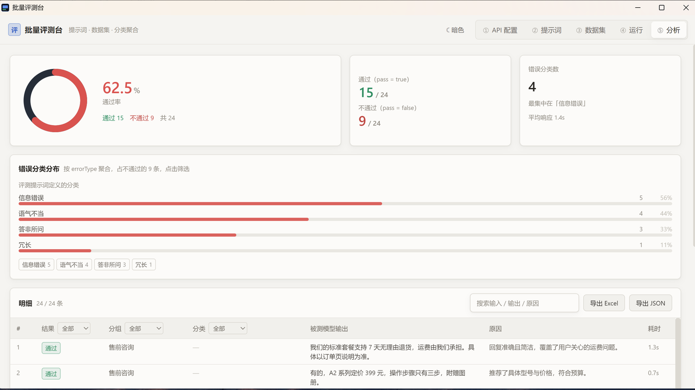
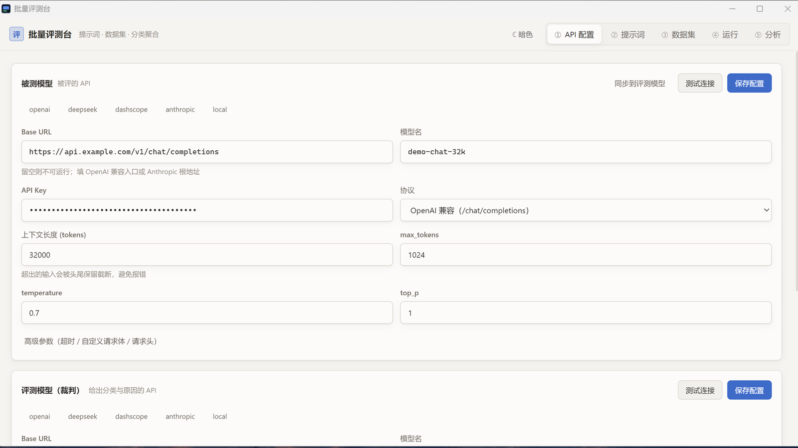
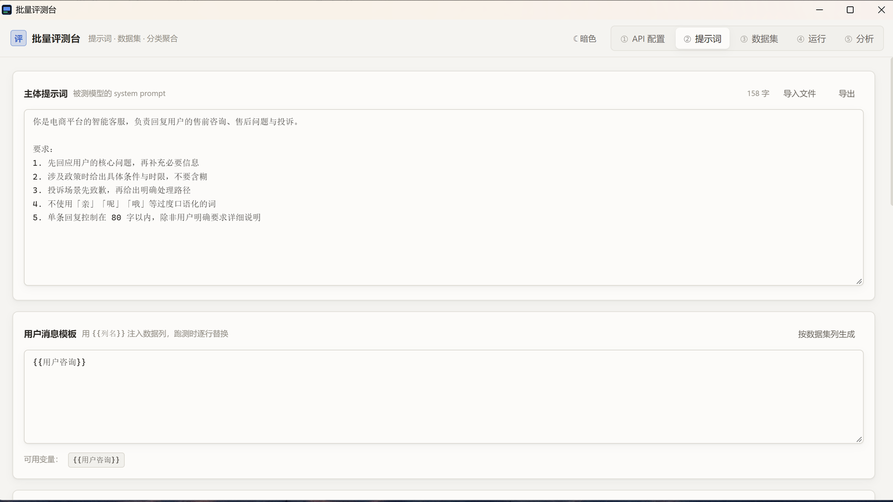
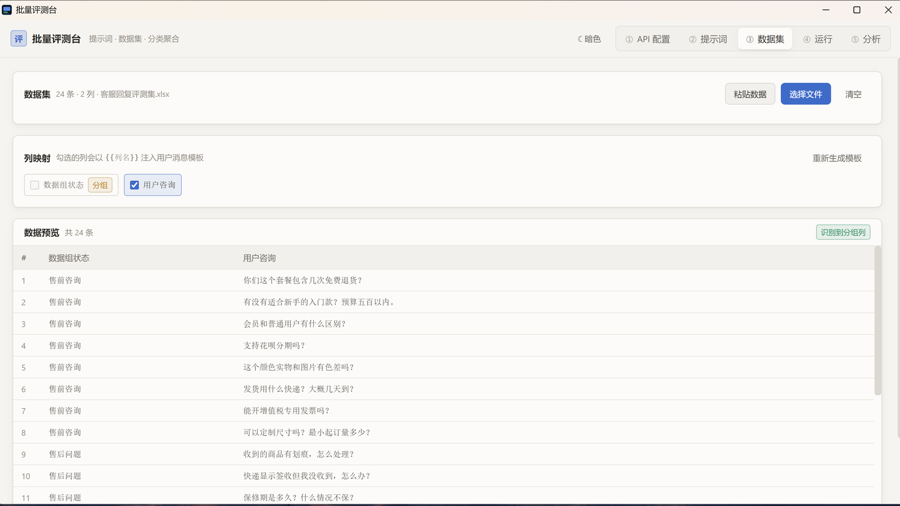
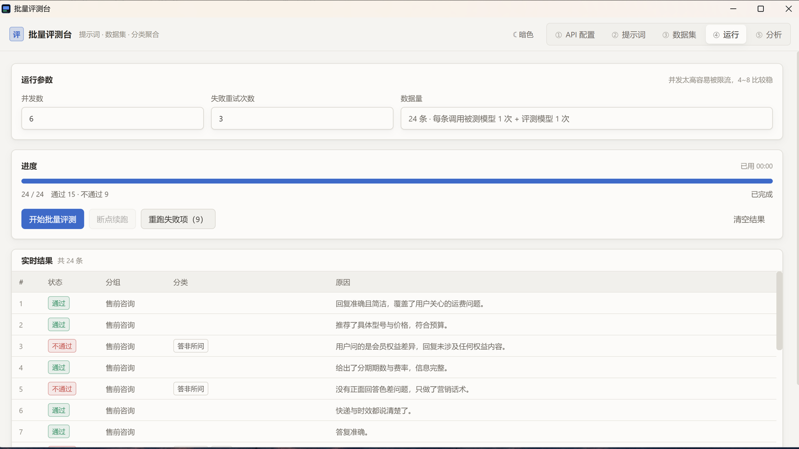
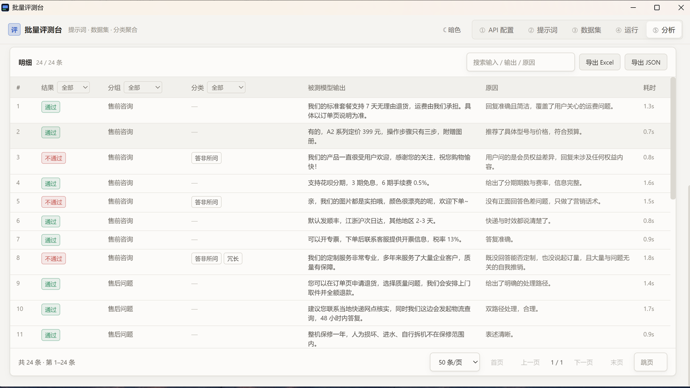

# 批量评测台

本地桌面工具。填好自己的 LLM API，批量跑评测数据，按评测提示词给出的分类统计结果。

Windows 和 macOS 都能用。



## 功能

- **被测模型**和**评测模型**分开配置，可以填同一个 API，也可以分开
- 支持 OpenAI 兼容协议和 Anthropic 协议
- 数据集支持 CSV、TSV、Excel、JSON、JSONL 和纯文本
- 并发调用，遇到 429 / 503 自动降速重试
- 结果按评测提示词输出的 `errorType` 聚合
- 支持**断点续跑**和**失败项重跑**
- 导出 CSV 或 JSON

## 安装

从 [Releases](https://github.com/catblav/batch-eval/releases/latest) 下载对应平台的安装包。

### Windows

下载 `BatchEval_0.1.1_x64-setup.exe` 运行安装。

### macOS

下载 `BatchEval_0.1.1_macOS_universal.dmg`，打开后把应用拖进 Applications。包里同时有 Apple Silicon 和 Intel 两种架构。

安装包没有做 Apple 公证，第一次打开要**右键点图标选打开**。如果系统仍然拦截，在终端执行：

```bash
xattr -cr "/Applications/批量评测台.app"
```

## 使用

界面分五个页面，按顺序操作。

### 1. API 配置

填两个模型的 Base URL、API Key 和模型名。

被测模型负责生成输出，评测模型负责逐条判定。判定要求稳定时，评测模型用 temperature 0。

协议选 OpenAI 兼容或 Anthropic。其它可配项有上下文长度、max_tokens、temperature、top_p、超时、自定义请求体和请求头。填完可以点 **测试连接** 验证。



### 2. 提示词

主体提示词是被测模型的 system prompt。

用户消息模板用 `{{列名}}` 注入数据列的值。

评测提示词是裁判模型逐条调用的内容，必须包含 `{{input}}` 和 `{{output}}`。

页面下方会实时显示实际发送给 API 的完整内容，方便检查变量替换是否正确。



### 3. 数据集

导入或粘贴数据。格式支持 CSV、TSV、Excel、JSON、JSONL 和纯文本。

编码自动识别，UTF-8 读不出来时按 GB18030 再试一次。

勾选需要注入的列，会自动生成用户消息模板。列名里包含 `数据组状态` 时，会把它当作**分组列**，运行页和分析页按它分组。



### 4. 运行

设置并发数和失败重试次数，点开始。

运行过程中可以看到每一条的通过状态、分类和原因，也可以中途取消。

结果会增量写入磁盘。中断后重新打开，点 **断点续跑** 只补没跑完的部分。失败项可以单独重跑。



### 5. 分析

顶部是通过率、通过和不通过的条数、错误分类数量、平均响应时间。

中间是错误分类分布，按条数排序，点分类可以筛选。

下面是明细表，支持按结果、分组、分类筛选和关键词搜索。**点任意一行**打开详情，能看到原始数据、实际发送的消息、被测模型的输出、裁判模型的原始输出和判定原因。



## 数据处理

评测分类完全来自评测提示词输出的 `errorType`，工具本身不内置任何分类。

**只有三种情况**会用工具自带的分类，并且和用户分类分开统计：

- 被测模型调用失败
- 评测模型调用失败
- 评测输出解析失败

裁判模型返回的内容不一定是标准 JSON，可能包在代码块里，或者字段名写成 `error_type`。解析时先剥代码块，再按括号配平提取 JSON，最后做字段名大小写和同义词兼容。都解析不出来才归到「评测输出解析失败」。

输入超过上下文的会做截断，保留头 60% 和尾 40%，详情里会标记。

## 数据存储

配置和数据都在本地用户目录下：

```
Windows:  %APPDATA%\com.batcheval.app\
macOS:    ~/Library/Application Support/com.batcheval.app\
```

```
settings.json               配置、提示词、列选择、主题
dataset.json                数据集
runs/current/meta.json      当前运行的元信息
runs/current/results.jsonl  每跑完一条追加一行
```

**只保留当前一次运行**，重新跑会清空上一次的结果。

**API Key 明文保存在本地**，不会发送到其它地方。

## 开发

需要 Node 18 以上、Rust stable，以及 Tauri 对应平台的系统依赖。

```bash
npm install
npm run tauri dev
```

打包：

```bash
npx tauri build
```

Windows 会生成 exe 和 NSIS 安装包。macOS 的构建配置在 `.github/workflows/build-macos.yml`，推送 tag 自动构建 dmg。

前端用 Vue 3、Vite 和 Tailwind，后端用 Rust。

## 测试

```bash
cd src-tauri
cargo test --lib
```

端到端测试需要先启动 mock 服务：

```bash
node ../tests/mock-api.mjs
cargo test --lib -- --ignored --nocapture
```

压测时在项目根目录生成一万行数据集，再让 mock 服务变慢并按比例失败：

```bash
node tests/gen-dataset.mjs 10000
MOCK_DELAY_MS=300 MOCK_FAIL_RATE=0.05 node tests/mock-api.mjs
```
