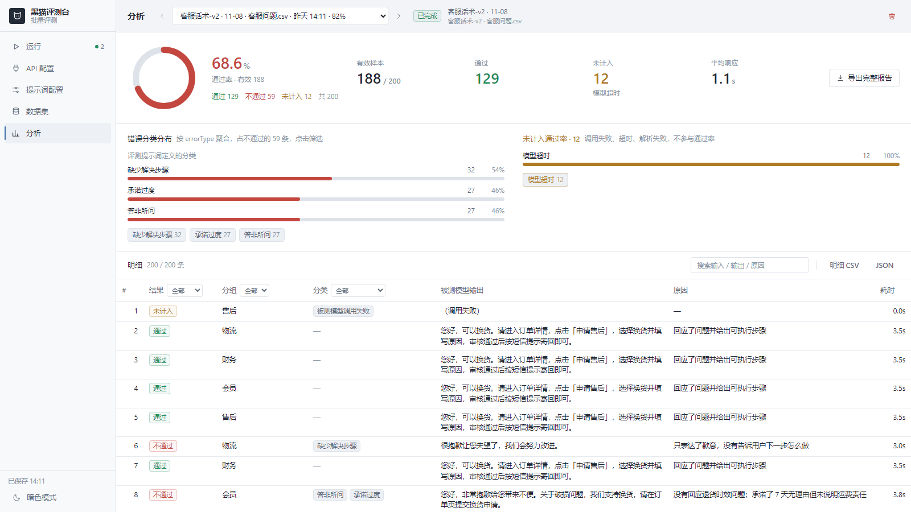
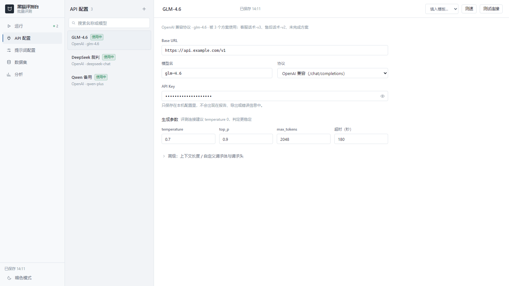
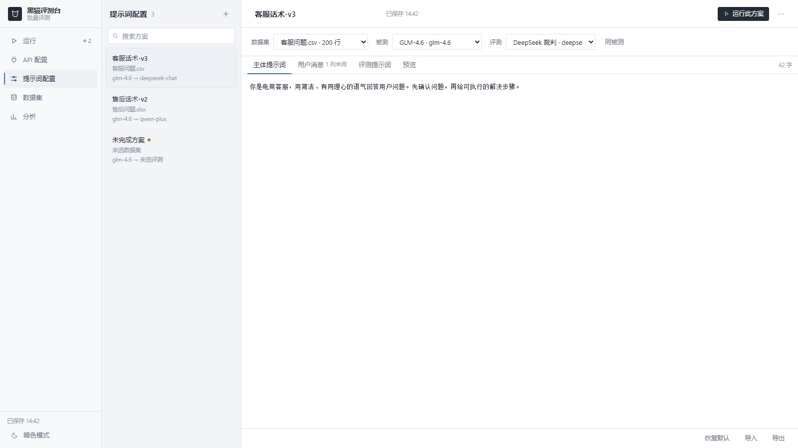
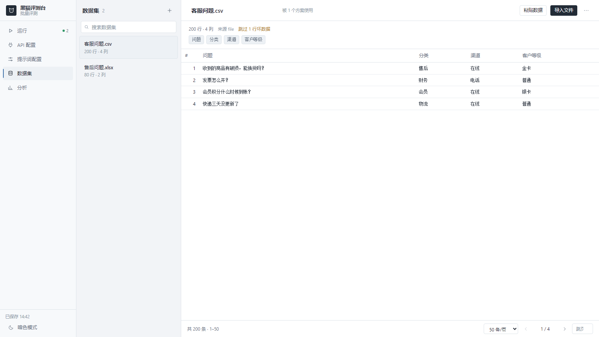
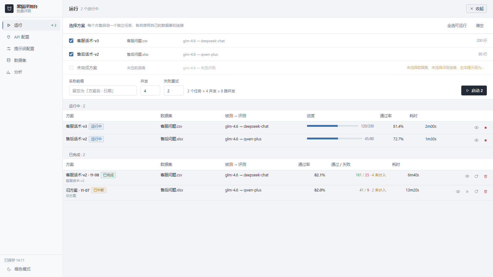
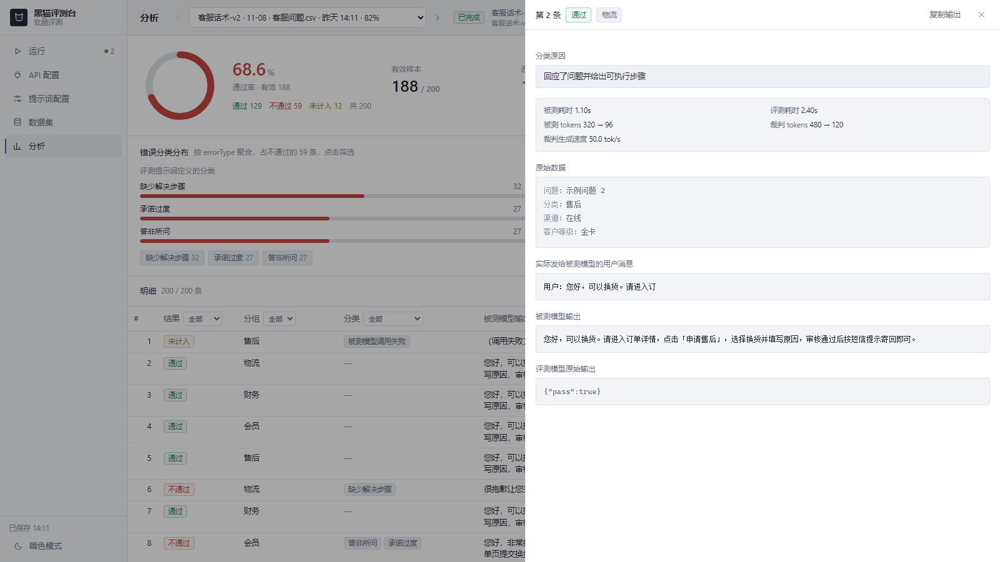

# 黑猫-自动评测台

本地桌面工具。填好自己的 LLM API，批量跑评测数据，按评测提示词给出的分类统计结果。
（更新）新增自动脚本，接入agent可自动跑测评数据，自动迭代提示词。

支持win和mac。




## 安装

从 [Releases](https://github.com/catblav/batch-eval/releases/latest) 下载对应平台的安装包。

### Windows

下载 `Heimao-AutoEval_0.1.3_x64-setup.exe` 运行安装。

### macOS

下载 `Heimao-AutoEval_0.1.3_macOS_universal.dmg`，打开后把应用拖进 Applications。包里同时有 Apple Silicon 和 Intel 两种架构。

安装包没有做 Apple 公证，第一次打开要**右键点图标选打开**。如果系统仍然拦截，在终端执行：

```bash
xattr -cr "/Applications/黑猫-自动评测台.app"
```

## 使用

界面分五个页面，按顺序操作。

### 1. API 配置

填两个模型的 Base URL、API Key 和模型名。

被测模型负责生成输出，评测模型负责逐条判定。

其它可配项有上下文长度、max_tokens、temperature、top_p、超时、自定义请求体和请求头。填完可以点 **测试连接** 验证。



### 2. 提示词

主体提示词是被测模型的 system prompt。

用户消息模板用 `{{列名}}` 注入数据列的值。

评测提示词是裁判模型逐条调用的内容，必须包含 `{{input}}` 和 `{{output}}`。

页面下方会实时显示实际发送给 API 的完整内容，方便检查变量替换是否正确。



### 3. 数据集

导入或粘贴数据。格式支持 CSV、TSV、Excel、JSON、JSONL 和纯文本。



### 4. 运行

设置并发数和失败重试次数，点开始。

运行过程中可以看到每一条的通过状态、分类和原因，也可以中途取消。

中断后可以重新打开，点 **断点续跑** 可以继续跑没跑完的部分，失败项也可以单独重跑。



### 5. 分析

支持查看通过率、通过和不通过的条数、错误分类数量、平均响应时间。

页面会显示错误分类分布，按条数排序，点分类可以筛选。

下面是明细表，支持按结果、分组、分类筛选和关键词搜索。点任意一行打开详情，能看到原始数据、实际发送的消息、被测模型的输出、裁判模型的原始输出和判定原因。



## 自动迭代脚本

### 用途

如果你在用 Claude、Codex 这类 agent 工具，把这个脚本交给它，agent 就能帮你自动跑提示词测试，并根据测试结果持续修改提示词。

### 使用方法

1. 下载并安装「黑猫-自动评测台」。
2. 复制下面这段话，把这句话发给你的agent（claude code/codex等）：

   > 请读取 `<安装目录>/auto-iterate/guide_agent.md`

剩下的流程将由agent引导你完成：指定工作目录、配置 API、放提示词和数据集，然后读文件、跑测试、改提示词。

### 建议

第一次建议自己先跑一遍，配置好 API、提示词和数据集，确认能正常出结果。之后就可以让 AI 帮你批量跑、自动改。当然，如果使用脚本，AI 也会读取使用说明教你配置好。

## 数据处理

评测分类来自评测提示词输出的错误分类，工具本身不内置任何分类。

**只有以下三种情况**会用工具自带的分类，并且和用户分类分开统计：

- 被测模型调用失败
- 评测模型调用失败
- 评测输出解析失败

输入超过上下文的会做截断，保留头 60% 和尾 40%，详情里会标记。

## 数据存储

配置和数据都在本地用户目录下：

```
Windows:  %APPDATA%\com.batcheval.app\
macOS:    ~/Library/Application Support/com.batcheval.app\
```

```
settings.json               配置、提示词、列选择、主题
dataset.json                数据集
runs/current/meta.json      当前运行的元信息
runs/current/results.jsonl  每跑完一条追加一行
```

**只保留当前一次运行**，重新跑会清空上一次的结果。

**API Key 明文保存在本地**，不会发送到其它地方。

## 详细功能

### API 配置

- **被测模型**和**评测模型**分开配置，支持一键同步
- 可配上下文长度、`max_tokens`、`temperature`、`top_p`、超时、自定义请求体与请求头
- 填完可点「测试连接」验证
- 「测速」发 3 次短请求，给出实际延迟和 tok/s

### 提示词

- 主体提示词作为被测模型的 system prompt
- 用户消息模板用 `{{列名}}` 注入数据列
- 评测提示词包含 `{{input}}`（被测模型收到的提示词 + 本条输入）和 `{{output}}`（被测模型的实际输出）
- 页面下方实时预览
- 「恢复默认」先预览再覆盖

### 数据集

- 支持 CSV、TSV、Excel、JSON、JSONL 和纯文本
- 勾选注入列自动生成模板
- 超量数据和坏行都有提示

### 运行

- 连续多条调不通会自动叫停，避免把整批数据白跑完
- **断点续跑**
- **失败项重跑**
- **取消立即生效**
- 结果增量落盘，实时结果可分页查看

### 分析

- 通过率按有效样本计算，调用失败 / 模型超时 / 解析失败单列为「未计入」
- 结果按评测提示词输出聚合，分类分布可点击筛选
- 明细表支持按结果、分组、分类筛选和关键词搜索
- 点任意一行看详情：原始数据、实际发送的消息、被测输出、裁判原始输出、判定原因
- 详情里有两侧的 token 用量和裁判生成速度

### 导出

- 导出 CSV 或 JSON，支持大结果分块写盘
- 导出完整报告：一个 xlsx，包含概览、错误分类、明细三个 sheet，带标题条、指标卡、状态色和冻结表头

### 自动迭代

- 自动迭代脚本和说明随应用安装
- 只用 Python 标准库，Python 3.8 以上即可
